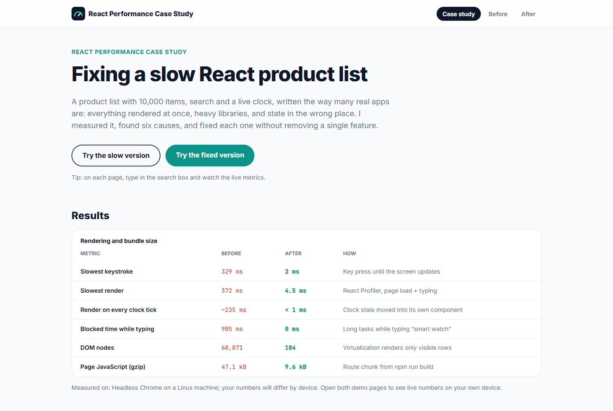

# React Performance Case Study

A slow React product list (10,000 items, search, live clock) measured, diagnosed and fixed. Both versions are live, with a metrics panel powered by the React Profiler API so you can feel the difference yourself.

**Live demo:** https://chennareddy-perf.vercel.app · [Slow version](https://chennareddy-perf.vercel.app/before) · [Fixed version](https://chennareddy-perf.vercel.app/after)



## Results

| Metric | Before | After |
| --- | --- | --- |
| Slowest keystroke (key press to screen) | 329 ms | 2 ms |
| Slowest render | 372 ms | 4.5 ms |
| Render on every clock tick | ~235 ms | < 1 ms |
| Blocked time while typing “smart watch” | 905 ms | 0 ms |
| DOM nodes | 60,071 | 184 |
| Page JavaScript (gzip) | 47.1 kB | 9.6 kB |

Measured in Chrome on the production build. Numbers vary by device; the live panel on each page shows yours.

## What was wrong, and the fix

| # | Problem | Fix |
| --- | --- | --- |
| 1 | All 10,000 rows rendered at once | Virtualized list with `@tanstack/react-virtual` |
| 2 | `moment` and all of `lodash` for small jobs | Built-in `Intl` formatters |
| 3 | Clock state in the page re-rendered everything every second | Moved into its own `<Clock />` component |
| 4 | Search text and dates recomputed on every render | Search index built once, results in `useMemo` |
| 5 | Typing waited for filtering | `useDeferredValue` keeps the input instant |
| 6 | Every row re-rendered on any change | `React.memo` rows and a `useCallback` handler |

Compare `src/pages/BeforePage.tsx` (problems marked `SLOW:`) with `src/pages/AfterPage.tsx` (fixes marked `FIX:`).

## How it's measured

- **React Profiler API** (`<Profiler onRender>`) records every render. The app uses React's profiling build (`vite.config.ts`), because React disables the Profiler in normal production builds.
- The metrics live in a small external store read with `useSyncExternalStore`, so recording a render never causes another render.
- **Long tasks** while typing were captured with a `PerformanceObserver`.
- **Bundle sizes** come from the `npm run build` output (each page is its own lazy-loaded chunk).

### Measure it yourself

1. Open the deployed site in Chrome and press F12.
2. **Lighthouse** tab → Mode: Navigation, Device: Desktop → Analyze, once for `/before` and once for `/after`.
3. **Performance** tab → Record, type in the search box, Stop. Compare the red long-task markers on both pages.

## Tech stack

React 19, TypeScript, Vite, Tailwind CSS v4, React Router, TanStack Virtual.

## Run locally

```bash
npm install
npm run dev
npm run build && npm run preview   # measure the production build
```
